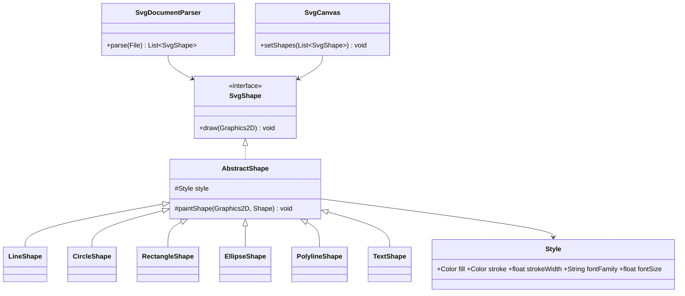

# Respuestas — Práctica de Java DOM, SVG y Java 2D

## Actividad 1. Estructura XML de SVG

SVG es XML: el elemento raíz `<svg>` define el lienzo y cada etiqueta hija describe una figura. Al construir el DOM, `<svg>` se convierte en un `Element` raíz; sus etiquetas hijas son nodos `Element` y los pares atributo-valor se consultan con `getAttribute`.

En el ejemplo, el nodo `line` contiene `x1`, `y1`, `x2` y `y2`; éstos determinan los dos extremos de un `Line2D.Double`. `stroke="blue"` y `stroke-width="3"` determinan color y grosor. El nodo `circle` contiene `cx`, `cy` y `r`; Java 2D recibe un `Ellipse2D.Double(cx-r, cy-r, 2r, 2r)`. Sus atributos `fill` y `stroke` se aplican respectivamente antes de rellenar y de dibujar el contorno.

## Actividad 2. Procesador DOM

`SvgDocumentParser` configura `DocumentBuilderFactory` con espacios de nombres, procesamiento seguro y sin entidades externas. El flujo es:

1. valida que el archivo exista y sea legible;
2. crea `DocumentBuilder` y obtiene un `Document`;
3. valida que su raíz sea `svg`;
4. recorre los `Node` hijos en el orden original;
5. cuando encuentra `g`, lo recorre recursivamente; y
6. convierte cada elemento soportado en un objeto `SvgShape`.

Las conversiones de números y colores están centralizadas en `SvgValues`; los errores incluyen el nombre del elemento y del atributo. Los nodos no incluidos en el alcance se ignoran. Al recorrer `NodeList` de izquierda a derecha, y anexar cada figura inmediatamente, se conserva la superposición definida en SVG.

## Actividad 3. Diseño orientado a objetos



`SvgShape` ofrece una única operación de dibujo; cada figura conoce sus datos geométricos. `Style` reúne las propiedades de presentación compartidas. El analizador solamente crea figuras y el panel solamente dibuja figuras ya creadas. Para añadir otro elemento se implementaría una nueva figura y se agregaría un caso controlado al analizador, sin alterar la interfaz ni el lienzo.

## Actividad 4. Renderizado

| Elemento | Interpretación y representación |
|---|---|
| `line` | Crea `Line2D.Double(x1, y1, x2, y2)` y dibuja sólo el contorno. |
| `circle` | Calcula el cuadro `(cx-r, cy-r, 2r, 2r)` y usa `Ellipse2D.Double`. |
| `polyline` | Convierte `points` a pares `double`, forma un `Path2D` abierto para el contorno y lo cierra únicamente en la operación de relleno. |
| `rect` | Usa `Rectangle2D.Double(x, y, width, height)`. |
| `ellipse` | Calcula `(cx-rx, cy-ry, 2rx, 2ry)` con `Ellipse2D.Double`. |
| `text` | Extrae `getTextContent()`, crea la fuente indicada y llama `drawString` en `(x,y)`, que es su línea base. |

Para figuras cerradas se rellena antes de trazar el contorno. Las propiedades predeterminadas del subconjunto son `fill=black`, `stroke=none`, `stroke-width=1`, `font-family=SansSerif` y `font-size=16`; `none` desactiva el relleno o contorno. Se aceptan colores básicos y `#RGB`/`#RRGGBB`.

## Actividad 5. Interfaz gráfica

`SvgViewerFrame` presenta el botón **Abrir SVG**, un selector que filtra extensiones SVG, un `SvgCanvas` y una barra de estado. Al elegir un archivo, la ventana invoca al procesador; si el resultado es válido, entrega la lista al panel y éste llama a `repaint`. `paintComponent` no lee archivos ni procesa XML: únicamente configura antialiasing y ejecuta `draw` respetando el orden de la lista. Los fallos se muestran tanto en la barra de estado como en un diálogo descriptivo. Puede seleccionarse otro archivo en cualquier momento.

## Actividad 6. Pruebas e integración

El archivo [`samples/test_svg_dom.svg`](../samples/test_svg_dom.svg) contiene doce figuras: dos líneas, dos círculos, dos polilíneas, dos rectángulos, dos elipses y dos textos; varias están dentro de un grupo `g`.

| Verificación | Evidencia |
|---|---|
| El archivo se abre e identifica elementos | `SvgDocumentParserTest` exige exactamente 12 figuras. |
| Coordenadas, tamaños, colores y grosores | Cada atributo del archivo de prueba usa valores diferentes y se transfiere a las clases de figura. |
| Orden de dibujo | El recorrido DOM secuencial añade y dibuja las figuras en el mismo orden. |
| Atributos inválidos | Números no finitos/no numéricos, radios negativos, grosores no positivos y colores fuera del alcance producen `IllegalArgumentException` descriptiva. |
| XML mal formado | `DocumentBuilder.parse` propaga un error que la ventana muestra al usuario. |
| Segunda carga | El botón puede utilizarse de nuevo y reemplaza la lista previa del lienzo. |
| Comparación con navegador | Al abrir el SVG de prueba en un navegador se observa la misma composición dentro de las limitaciones explícitas: seis elementos, atributos directos y colores simples. |

Ejecute la prueba desde la raíz del repositorio:

```bash
javac -d out $(find src/main/java src/test/java -name '*.java')
java -ea -cp out com.example.svgviewer.SvgDocumentParserTest
```

## Limitaciones deliberadas

No se implementan transformaciones, estilos CSS, herencia de atributos desde `g`, unidades distintas de números simples, rutas `path`, imágenes ni otros elementos SVG. Son elementos fuera del alcance declarado de la práctica.
